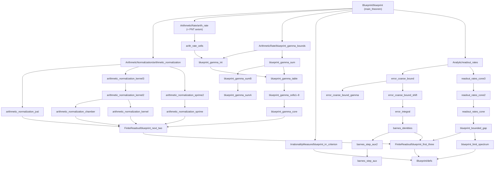

# A Lean formalization of `μ(ζ(2)) < 4.62675`

This repository formalizes, in Lean 4 with Mathlib, the article

> *CMF conservation as an arithmetic tool — A proof of `μ(ζ(2)) < 4.62675` for the direction
> `(10,9,11,-11;2,1,3)`* (10 October 2026),

whose source, PDF and Python certificates are in `results/zeta2_complete_proof/`.

**Main result.** The irrationality measure of `ζ(2)` satisfies

```
μ(ζ(2)) ≤ 1 + σ/τ = 62636575/13537936 < 4.62675,   σ = 49.098639,  τ = 13.537936.
```

The whole proof is formalized: there is no `sorry` in the repository. The proof depends on Lean's
three standard axioms (`propext`, `Classical.choice`, `Quot.sound`) and on **one additional
axiom**, the prime number theorem in the form `θ(x)/x → 1`
(`Zeta2ArithRate.prime_number_theorem`, used only for the arithmetic rate of §5), which is not
yet available in Mathlib.

## Checking the main theorem

The entry point is [`Zeta2FourTrajectoryMatrices/MainTheorem.lean`](Zeta2FourTrajectoryMatrices/MainTheorem.lean).
It spells out `ζ(2)`, `IrrMeasureLE` and `irrationalityMeasure`, restates the theorem as
`zeta2_irrationality_measure`, checks it against `Zeta2Blueprint.main_theorem`, and prints its
axioms:

```bash
lake exe cache get
```

```bash
lake build
```

```bash
lake env lean Zeta2FourTrajectoryMatrices/MainTheorem.lean
```

The last command prints

```
'zeta2_irrationality_measure' depends on axioms: [propext, Classical.choice, Quot.sound,
 Zeta2ArithRate.prime_number_theorem]
```

Toolchain: `leanprover/lean4:v4.35.0-rc4`, Mathlib `v4.35.0-rc4` (see `lean-toolchain`,
`lakefile.toml`). The single library `Zeta2FourTrajectoryMatrices` contains every module.

## Repository layout

All Lean sources live in `Zeta2FourTrajectoryMatrices/`; the root file
`Zeta2FourTrajectoryMatrices.lean` imports all of them.

### `Blueprint/` — the statement of the article

| File | Contents |
|---|---|
| `defs.lean` | All definitions of the blueprint (namespace `Zeta2Blueprint`): the `pFq(4,3,1)` matrix field (`Qw`, `Tw`, `stepMat`, `walk`, `route`, `W`, `readout`), the readout data (`binomPoly`, `Fpoly`, `CN`, `cj`, `Spoly`, `harm2`, `Jfun`), the arithmetic data (`lcmUpTo`, `rho`, `phi`, `GN`, `InShell`, `HN`, `kN`, `gammaRate`), the analytic data (`zeta2`, `Err`, `barnesI`, `Lker`, `Tinf`, `Ainf`) and the irrationality measure (`IrrMeasureLE`, `irrationalityMeasure`). |
| `blueprint.lean` | The 20 blueprint nodes, following the sections of the article, down to `main_theorem`. Each node is proved here, either directly or by citing the theorem of the same name proved in the files below. |
| `../MainTheorem.lean` | Entry point: restatement, `#check` and `#print axioms` of the main theorem. |

### `FiniteReadout/` — §3, Appendices A–B: the exact native readout

| File | Contents |
|---|---|
| `blueprint_first_three.lean` | The toy conservation example, independence of the two four-block routes (`route_independent`), and the exact finite readout `C_N R W(N) e_r = 2(∑ j^r c_j H^{(2)}_{j+η} + J_η(S_r), ∑ j^r c_j)` (`readout_formula`). |
| `blueprint_next_two.lean` | The carry function `χ` and its relation to `ρ`, `φ`; the finite-field quotient `𝒬` and its degree (`polyQ_factor`); the `p`-integrality toolkit (`pInt`, `IntVal`); and the baseline integrality `C_N d_{12N} d_{13N+r} / G_N · R W(N) e_r ∈ ℤ²` (`baseline_integrality`). |

### `ArithmeticNormalization/` — §4, Appendix D: the six prime shells

| File | Contents |
|---|---|
| `arithmetic_normalization.lean` | Theorem 1: `C_N d_{12N} d_{13N+r} / (G_N H_{N,r}) · R W(N) e_r ∈ ℤ²`. Shell-prime bookkeeping, the vanishing sum (V), reduction of harmonic numbers, the harmonic part (`harm_val`) and the assembly. |
| `arithmetic_normalization_chamber.lean` | The chamber table (T): on residues of minimal carry the digit data `(e, λ, δ)` is constant (eight chambers, with the split values excluded by `p² > 50N`). |
| `arithmetic_normalization_kernel.lean` | Shared machinery for the local kernel: factorial and binomial leading terms modulo `p` (Wilson, Lucas), and the evaluation of `𝒬(k)` from root multiplicities. |
| `arithmetic_normalization_kernel2.lean` | Residues of the whole kernel (C'): `p^{-h} c_{k+lp} ≡ κ 𝒬(k) A_l (mod p)`. |
| `arithmetic_normalization_kernel3.lean` | The local factorization (R) of `F·L_{11N}` at the points `k + pV` of a window. |
| `arithmetic_normalization_sprime.lean` | Reduction of `T_r = p^{1-h} S_r` along `k + pV` to a polynomial in `V` of degree `< K` (Newton expansion and Lucas). |
| `arithmetic_normalization_sprime2.lean` | The divided-difference kernel (S'): `T_r(k + pV) ≡ κ k^r 𝒬(k) B(V) (mod p)`. |
| `arithmetic_normalization_jval.lean` | The polynomial part `J_η(S_r)` gains a factor `p` (Lucas's congruence and the vanishing sum). |

### `ArithmeticRate/` — §5, Appendix E: the exponential cost `25 - γ - 233/120`

| File | Contents |
|---|---|
| `arith_rate.lean` | `log k_N / N → 25 - γ - 233/120`: the prime number theorem (**axiom**), `log d_n ~ n`, primes in linear windows, Chebyshev's bound, the six shells, and `log G_N / N → γ`. |
| `arith_rate_cells.lean` | The contribution of the primes `p > N/K` to `log G_N`, computed cell by cell from the window form of the prime number theorem. |
| `blueprint_gamma_core.lean` | Floor and threshold lemmas used to evaluate `φ` on a cell. |
| `blueprint_gamma_cells1.lean` … `blueprint_gamma_cells8.lean` | The value of `φ` on each of the 94 cells of the partition of `[0, 1)`. |
| `blueprint_gamma_table.lean` | The 94-cell table (cut points and heights) and its basic properties. |
| `blueprint_gamma_sumA.lean`, `blueprint_gamma_sumB.lean`, `blueprint_gamma_sum.lean` | The directed-rounding sum over the first 2000 periods, by kernel computation. |
| `blueprint_gamma_int.lean` | `γ` as the sum over periods and cells plus an integral tail. |
| `blueprint_gamma_bounds.lean` | The rational enclosure of `γ` (`gamma_bounds`). |

### `Analytic/` — §6: Barnes integral, decay, spectrum, rates, independence

| File | Contents |
|---|---|
| `barnes_step_aux.lean`, `barnes_step_aux2.lean` | Crossing one double pole of `(π / sin πs)²`: residue `g'(n)` via the rectangle Cauchy theorem. |
| `barnes_identities.lean` | `𝓘_η(P) = J_η(P)` and `𝓘_η(1/(s-j)) = H^{(2)}_{j+η} - ζ(2)` (`barnes_identities`). |
| `error_integral.lean` | (A1): `C_N 𝖤_{N,r} = -2 𝓘_η(s^r F_N L_m)` (`error_integral`). |
| `error_coarse_bound_gamma.lean` | The rotated Euler integral bound `|Γ(a+iy)| ≤ Γ(a) (cos θ)^{-a} e^{-θ|y|}`. |
| `error_coarse_bound_shift.lean` | Moving the contour from `Re s = -6N - 1/2` to `Re s = -6N` (removable singularity). |
| `error_coarse_bound.lean` | (A2)–(A4): the Gamma form, the coarse bound, Stirling, and `|C_N 𝖤_{N,r}| ≤ e^{-18N}` (`error_coarse_bound`). |
| `blueprint_limit_spectrum.lean` | The limiting matrix `A_∞`, its characteristic polynomial, discriminant, real root `-Λ` and observability determinant (`limit_spectrum`). |
| `blueprint_bounded_gap.lean` | `A_N → A_∞`, invertibility of `W(N)`, and the bounded gap of at most two (`bounded_gap`). |
| `readout_rates_cone.lean`, `readout_rates_cone2.lean`, `readout_rates_cone3.lean` | The invariant-cone argument, without an eigenbasis (spectral projections and an adapted quadratic form). |
| `readout_rates.lean` | (A7)–(A8): the sharp rates `log Λ` and `log ρ`, `C_N ≤ e^{c_C N}`, and the certified enclosures (`readout_rates`). |

### `IrrationalityMeasure/` — §6.6

| File | Contents |
|---|---|
| `blueprint_irr_criterion.lean` | The irrationality criterion: integer forms of growth `σ`, decay `τ` and bounded gap give `μ(α) ≤ 1 + σ/τ` (`irrMeasure_criterion`). |

### Other folders

* `results/` — the article (`zeta2_complete_proof.tex`, `.pdf`), its Python certificates
  (`code/`) and earlier numerical results. The Lean proof does not depend on running them.
* `work/` — intermediate analytic certificates.

## How the blueprint nodes are proved

| Blueprint node (`Zeta2Blueprint.*`) | Proof |
|---|---|
| `toy_conservation`, `sum_eval_eq_zero`, `shell_lengths` | directly in `blueprint.lean` |
| `route_independent`, `readout_formula` | `Zeta2FirstThree.*` (`FiniteReadout/blueprint_first_three.lean`) |
| `baseline_integrality`, `polyQ_factor` | `Zeta2NextTwo.*` (`FiniteReadout/blueprint_next_two.lean`) |
| `arithmetic_normalization` | `Zeta2ArithmeticNormalization.*` |
| `gamma_bounds` | `Zeta2GammaBounds.*` |
| `arith_rate` | `Zeta2ArithRate.*` (uses the prime number theorem axiom) |
| `kN_rate` | in `blueprint.lean`, from `gamma_bounds` and `arith_rate` |
| `barnes_identities`, `error_integral`, `error_coarse_bound` | `Zeta2BarnesIdentities.*`, `Zeta2ErrorIntegral.*`, `Zeta2ErrorCoarseBound.*` |
| `limit_spectrum`, `bounded_gap` | `Zeta2LimitSpectrum.*`, `Zeta2BoundedGap.*` |
| `readout_rates` | `Zeta2ReadoutRates.*` |
| `irrMeasure_criterion` | `Zeta2IrrCriterion.*` |
| `zeta2_irrMeasureLE`, `main_theorem` | in `blueprint.lean`, from the nodes above |

## Dependency graph of `main_theorem`

Module-level dependencies of the constants used by `main_theorem` (edges implied by a longer path
omitted; the eight cell files are collapsed into one node). Every module of the library is used.



## Compile times

Times reported by `lake build` when the modules were built one at a time on a Windows laptop
(12 logical cores, 16 GB RAM). Each time includes loading Mathlib, which took about 20–50 s per
file on this machine. Entries marked `*` were already compiled when the timed run started, so
their time is the check-only wall time.

| Module | Time | Module | Time |
|---|---|---|---|
| `Blueprint/defs` | ~10 s* | `Analytic/barnes_step_aux` | 29 s |
| `FiniteReadout/blueprint_first_three` | ~11 s* | `Analytic/barnes_step_aux2` | 23 s |
| `FiniteReadout/blueprint_next_two` | 37 s | `Analytic/barnes_identities` | 24 s |
| `IrrationalityMeasure/blueprint_irr_criterion` | 32 s | `Analytic/error_integral` | 22 s |
| `Analytic/blueprint_limit_spectrum` | ~9 s* | `Analytic/error_coarse_bound_gamma` | 24 s |
| `Analytic/blueprint_bounded_gap` | 39 s | `Analytic/error_coarse_bound_shift` | 50 s |
| `ArithmeticRate/blueprint_gamma_core` | ~12 s* | `Analytic/error_coarse_bound` | 80 s |
| `ArithmeticRate/blueprint_gamma_cells1`–`8` | 24–32 s each | `Analytic/readout_rates_cone` / `2` / `3` | 50 / 56 / 54 s |
| `ArithmeticRate/blueprint_gamma_table` | 26 s | `Analytic/readout_rates` | 57 s |
| `ArithmeticRate/blueprint_gamma_sumA` / `B` | 35 / 36 s | `ArithmeticNormalization/arithmetic_normalization_chamber` | 56 s |
| `ArithmeticRate/blueprint_gamma_sum` | 28 s | `ArithmeticNormalization/arithmetic_normalization_jval` | 53 s |
| `ArithmeticRate/blueprint_gamma_int` | 29 s | `ArithmeticNormalization/arithmetic_normalization_kernel` / `2` / `3` | 58 / 53 / 62 s |
| `ArithmeticRate/blueprint_gamma_bounds` | 27 s | `ArithmeticNormalization/arithmetic_normalization_sprime` / `2` | 54 / 52 s |
| `ArithmeticRate/arith_rate_cells` | 49 s | `ArithmeticNormalization/arithmetic_normalization` | 63 s |
| `ArithmeticRate/arith_rate` | 57 s | `Blueprint/blueprint` | 55 s |

The modules from `error_coarse_bound_shift` onwards were built while the machine was more heavily
loaded, which accounts for most of their longer times.
